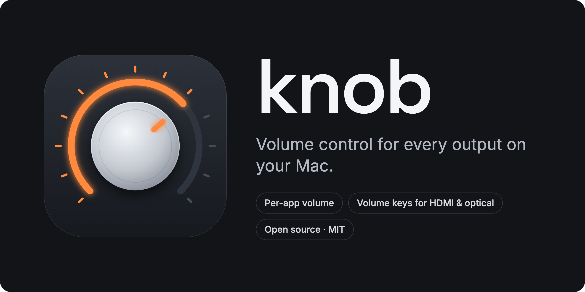
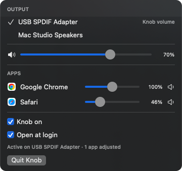
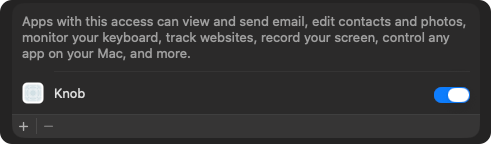

<div align="center">



[](#install)
[](https://www.swift.org)
[](LICENSE)
[](https://github.com/uphillbill/knob/actions/workflows/build.yml)
[](https://github.com/uphillbill/knob/releases)



</div>

## Why Knob

When your Mac plays through HDMI, DisplayPort or an optical (S/PDIF) adapter, macOS can't change the volume: the keys show a crossed-out speaker and the slider is greyed out. Your only option is the remote of the TV, monitor or soundbar. Knob puts the volume keys back in charge, and lets you turn individual apps up or down while it's at it.

## Features

| | |
|---|---|
| 🔊 **Volume keys for any output** | Volume up, down and mute work on HDMI, DisplayPort and optical outputs, with an on-screen indicator. Option+Shift gives finer steps. |
| 🎚️ **Per-app volume, 0–200%** | Turn a loud app down, boost a quiet one, or mute one app while the rest keep playing. |
| 🔀 **Output switching** | Pick the output from the menu bar. Knob remembers a volume for each device. |
| 🪶 **Zero overhead when not needed** | On a device with its own volume control and no per-app settings, Knob steps aside and audio is untouched. |

At 50%, Knob plays at exactly the level you'd hear without it. The top half of the slider boosts by up to +12 dB, with a soft limiter so loud peaks round off instead of crackling.

## How it works


Knob uses the **process tap APIs Apple added in macOS 14.2**. A tap captures an app's audio and mutes the original, so the only thing your output hears is Knob's mix: one tap for "everything else" and one for each app you've adjusted. Knob applies the gains in real time and plays the result through a private aggregate device built on your output.

There's **no kernel extension and no virtual audio driver** to install. The taps belong to the Knob process: if Knob quits or crashes, they disappear and audio goes straight to your device again.

## Known limitations

Knob is an early pre-release. Things to know:

- **Apps playing to a different output get moved.** While Knob's engine is running, an app that sends audio to another device (say, a call on headphones) is muted there and played on your current output instead. Device-specific taps will fix this; until then, turn Knob off for that call.
- **If you deny the audio recording permission, audio can go silent** instead of Knob stopping by itself. Turn Knob off (or `killall Knob`), then grant the permission in **System Settings → Privacy & Security → Screen & System Audio Recording**.
- **Tested mainly on Apple silicon with a USB optical adapter and built-in speakers.** Devices that also have inputs, sleep and wake, and unplugging an output mid-playback haven't been fully tested yet. Reports from other setups are very welcome.

## Privacy

- **No network access.** Knob makes no network connections, and no audio, settings or usage data ever leave your Mac.
- **Audio is processed in memory only.** Nothing is recorded or written to disk.
- **What Knob stores**: a few settings in `~/Library/Preferences/io.github.uphillbill.knob.plist`, and nothing else:

  | Setting | Stored as |
  |---|---|
  | Knob on/off | `isOn` |
  | Settings format version | `volumeCurveVersion` |
  | Volume and mute for each device without its own volume control | `deviceVolume.<device ID>`, `deviceMuted.<device ID>` |
  | Volume and mute for apps you've adjusted | `appVolume.<app ID>`, `appMuted.<app ID>` |

- **Diagnostics** go to the macOS system log on your Mac, like any app's. Routine messages are held in memory, detailed ones only appear while you're watching the log, only errors are saved to disk, and device IDs are redacted.
- macOS itself remembers the permissions you grant, and the login item if you turn on **Open at login**.

### The two permission prompts

- **System audio recording.** This lets Knob tap app audio so it can change the volume. macOS calls this "recording" because the same API could record, but Knob only adjusts the level and plays the audio straight back out. While Knob's engine runs, macOS may show its **recording indicator** in the menu bar or Control Center. That's expected.
- **Accessibility.** This lets Knob catch the volume keys before macOS does, so they control Knob instead of showing the "can't adjust" symbol. Knob only listens to the special media keys, acts only on volume and mute, and passes everything else through. On devices with their own volume control, it passes the volume keys through too.

## Install

Requirements: macOS 14.2 or later, Apple silicon, Xcode or the Command Line Tools.

```bash
xcode-select --install          # once, if needed
git clone https://github.com/uphillbill/knob.git
cd knob
./scripts/make-app.sh
```

The script builds Knob, installs it to `~/Applications/Knob.app` and launches it. Approve the audio recording prompt, then choose **Allow volume keys…** in the menu to grant Accessibility access.

**Optional signing.** By default the app is signed ad hoc, and macOS asks for the permissions again after every rebuild. To avoid that, sign with a stable identity (an Apple Development certificate, or a self-signed code-signing certificate made in Keychain Access):

```bash
cp .signing.env.example .signing.env    # then set SIGN_ID; the file is gitignored
```

**Gatekeeper.** An app you build on your own Mac isn't quarantined, so Gatekeeper doesn't block it. If you copy an unsigned build from another Mac or download one, macOS will refuse to open it: go to **System Settings → Privacy & Security** and click **Open Anyway**.

## Troubleshooting

**Audio went silent.** Open Knob's menu and turn **Knob on** off, or run `killall Knob` in Terminal. Audio goes straight to your device again immediately. Check [Known limitations](#known-limitations), and if it's not one of those, please [open an issue](https://github.com/uphillbill/knob/issues/new/choose) with what happened.

**The volume keys don't work.**
- Check **System Settings → Privacy & Security → Accessibility** and make sure Knob is on:

  

- If it already is on and you've rebuilt Knob, the entry may belong to the old build: select Knob, click **–** to remove it, then choose **Allow volume keys…** in Knob's menu again.
- On a device with its own volume control, the keys are handled by macOS, not Knob. That's by design.

**Knob keeps asking for permissions after a rebuild.** Ad-hoc signed builds look like a new app to macOS each time. Sign with a stable identity (see [Install](#install)), then grant the permissions one last time.

**Logs**, for bug reports:

```bash
/usr/bin/log stream --predicate 'subsystem == "io.github.uphillbill.knob"' --level debug
```

## Roadmap

- **Device-specific taps**, so an app you send to a different output (say, a call on headphones) is left alone
- **EQ**
- **Per-app output routing**
- **Loudness leveling** across apps
- **Hotkeys and Shortcuts** actions

## Contributing

Bug reports, hardware testing and pull requests are welcome. See [CONTRIBUTING.md](CONTRIBUTING.md) and the [Code of Conduct](CODE_OF_CONDUCT.md). Please report security issues privately as described in [SECURITY.md](SECURITY.md).

## License

[MIT](LICENSE) © 2026 Bill Nichols

## Acknowledgments

Built on Apple's Core Audio process tap APIs. See Apple's [Capturing system audio with Core Audio taps](https://developer.apple.com/documentation/coreaudio/capturing-system-audio-with-core-audio-taps) documentation and sample code.
